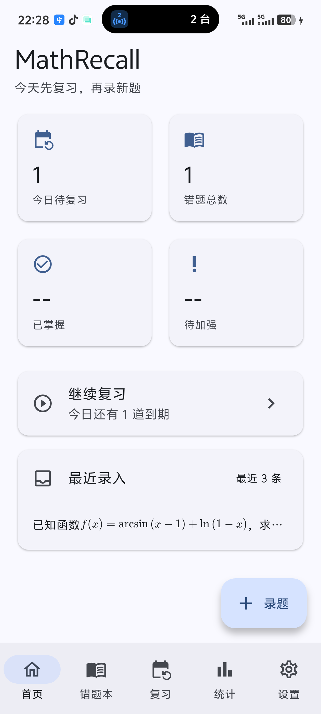
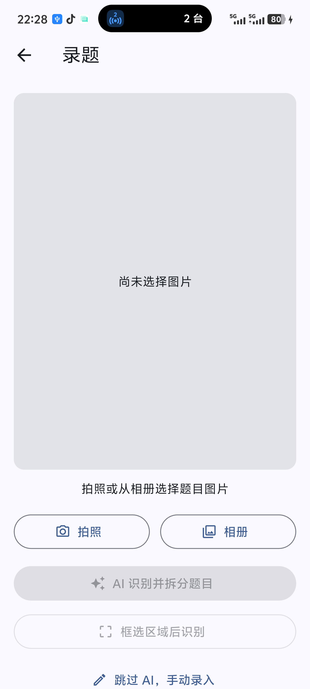
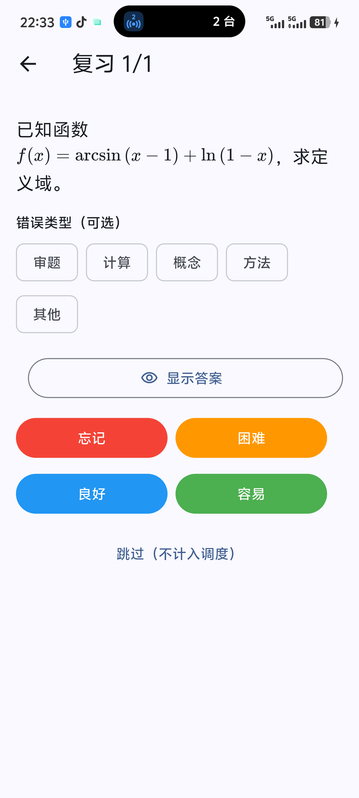
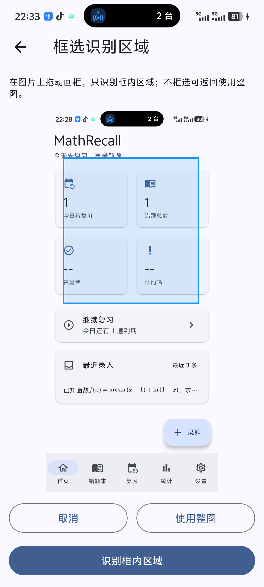

# MathRecall

考研数学错题管理 + AI 识题 + FSRS-6 间隔复习，Android 单机优先。

> 早期预览版（v1.0.0-preview）。AI 识别结果需要人工校对；题库、复习与统计仍在持续完善。

## 功能

- **知识点与标签**：科目 → 章节 → 知识点三级树，标签独立管理
- **错题本**：新增/编辑/删除/恢复、搜索、收藏、左滑操作、长按批量操作
- **录题**
  - 拍照 / 相册选择
  - **拍完/选完立即框选**，只识别框内区域
  - AI 识图拆题，逐题校对后批量入库
  - 识别后可给每道题**附加图片**（补充无法识别的内容）
- **AI 配置**：OpenAI-compatible 接口，支持 OpenAI / DeepSeek / 火山方舟 / Ollama 等；Key 存 Android Keystore
- **复习**：FSRS-6 调度、四档评分、跳过、卡住知识点/错误类型直证
- **公式渲染**：`$...$`、`$$...$$`、`\(...\)`、`\[...\]` 及裸 LaTeX
- **本地优先**：SQLite + 本地图片，无云同步

### 截图

| 首页 | 题目详情 |
|---|---|
|  |  |

| 复习 | 框选识别 |
|---|---|
|  |  |

## 技术栈

- Flutter 3.47.9 / Dart 3.13.7，Material 3
- Riverpod 3、Drift 2（SQLite）、sqlite3
- `image_picker`、`flutter_secure_storage`、`flutter_math_fork`、`flutter_slidable`
- `fsrs` 2.0.1（FSRS-6）
- 分层：presentation → application → domain，infrastructure 实现端口

## 构建运行

环境：Flutter 3.47+、Android SDK 36、JDK 21。

```bash
flutter pub get
flutter run
```

构建 APK：

```bash
flutter build apk --debug
# 或
cd android && ./gradlew assembleDebug
```

Release：

```bash
flutter build apk --release
```

### 配置 AI

应用内「设置 → AI 配置」填写：

- Base URL（如 `https://api.deepseek.com/v1`）
- 支持图片输入的多模态模型
- API Key（保存后不回显，可删除）

## 已知限制

- P6 掌握度、P7 备份恢复、P8 设置完善尚未完成
- AI 识别依赖第三方服务，结果需人工校对
- Release 版目前使用 debug 签名，正式发布前需配置签名
- 暂不支持云同步、鸿蒙、Windows 正式适配

## 路线图

- [ ] P6 掌握度与统计
- [ ] P7 完整备份 / 恢复（ZIP + manifest + SHA-256）
- [ ] P8 设置完善（阈值、测试连接、数据清理）
- [ ] 正式签名与 Release 渠道

## 数据与隐私

- 所有题目、图片、复习记录保存在本机应用私有目录
- API Key 仅存 Android Keystore，不写入数据库、不进入日志
- 使用 AI 时图片会上传到用户配置的服务商，请自行确认隐私政策

## License

[MIT](LICENSE)

## 免责声明

本项目仅用于个人学习与错题管理。AI 识别结果可能出错，请以人工校对为准；请勿上传你无权处理的题目内容。
